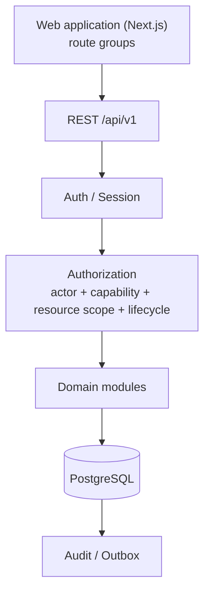

# 1hub.network

The shared identity, data and operating layer for the HUB ecosystem. This repository holds the
**Phase 0 (P0)** web application and its frozen source-of-truth (SOT) pack.

> This README is an entry point and is **not authoritative**. When it disagrees with a frozen
> SOT document, the SOT wins. See [Source of truth](#6-source-of-truth).

---

## 1. What is 1hub.network?

1hub.network connects the ecosystem's records into one canonical data layer:

- people and their identity;
- HUB, Chapters, Clubs (CLB) and other organizations;
- programmes and challenges;
- events;
- projects and startups;
- participation and outcomes.

**Core idea:** canonical, reusable records instead of isolated programme-owned copies. Activity
enriches one profile per person and per project, and that history later feeds discovery and matching.

Problems it addresses:

- ecosystem data fragmented across Forms, Sheets and Drives;
- members and projects re-entering the same information for every programme;
- activity and outcomes that never accumulate into reusable ecosystem profiles.

## 2. Phase 0 scope

| Workflow | Purpose | P0 mode |
|---|---|---|
| WF01 — Identity & Onboarding | Account access, initial profile, consent and visibility | Production |
| WF02 — Member Profile & Network | Profile, privacy, roles/network links, project/startup profile and team | Production |
| WF03 — HUB / Chapter / CLB Operations | Scoped unit operations: members, programmes, content, events, settings | Production/Internal |
| WF04 — Programme / Challenge Operations | Create, configure, publish and monitor a programme | Demo |
| WF05 — Project / Startup Journey | Journey on the canonical WF02 project | Demo |
| WF06 — Ecosystem Data / Discovery / Matching | Read models, discovery, matching | Future |

**Demo and Future scope must not silently become Production.** Investor/VC/Dataroom flows are
also Future.

Workflow contracts: [WF01](docs/workflows/WF01_IDENTITY_ONBOARDING_FINAL_v1.0.md) ·
[WF02](docs/workflows/WF02_MEMBER_PROFILE_NETWORK_FINAL_v1.0.md) ·
[WF03](docs/workflows/WF03_HUB_CHAPTER_CLB_OPERATIONS_FINAL_v1.0.md).

## 3. System architecture



- **Modular monolith** backend with explicit domain boundaries. Not microservices.
- **PostgreSQL** is the single primary database.
- **Versioned REST API** under `/api/v1`, with a frozen error envelope.
- **One web application** with route groups: public, auth, onboarding, member, ops (and demo).
- **Frontend routes are not a security boundary**; route guards exist for UX only.
- **The server is authoritative** for permissions, lifecycle transitions and data filtering.
- Schema changes ship as **additive, numbered migrations**; an applied migration is never rewritten.

**Logical vs current layout.** The architecture defines Web and API as separate components. In
this repository both live in one Next.js project: UI route groups and `/api/v1` route handlers
sit side by side under `src/app/`.

Details: [architecture docs](docs/architecture/).

## 4. Core domain & security rules

Read these before writing any code. The [Data SOT](docs/product/1HUB_DATA_SOT_v1.1.md) is the
full definition.

```text
UserAccount   ≠  IndividualProfile  ≠  IdentityVerification      (one account → one root profile)
Membership    ≠  Leadership  ≠  OrganizationRepresentation  ≠  RoleAssignment (permission)
Consent       ≠  Visibility
```

| Concept | Rule |
|---|---|
| Project / Startup | Canonical and reusable across programmes; never copied per programme |
| Programme / Challenge | One canonical `Programme` aggregate with subtype `PROGRAMME \| CHALLENGE` |
| Event | Canonical; standalone or linked to a Programme |
| Membership | Self-selection never auto-creates ACTIVE membership |
| Profile completion | Server-derived; the client never submits a percentage |
| Taxonomy | REGION / DOMAIN / SKILL are controlled-vocabulary IDs |

Every protected server operation checks:

```text
actor + capability + resource scope + lifecycle
```

- Authorization runs server-side; role or scope is never trusted from the client.
- Browser session uses a secure, HTTP-only cookie.
- APIs return DTOs, never raw DB rows.
- Visibility and consent filters apply **before** serialization.
- Sensitive mutations (role, membership, consent, visibility, representation) produce audit events.
- Never invent business rules, enums, statuses, routes or permissions to fill a gap.

## 5. Repository structure

Actual layout; generated folders (`node_modules/`, `.next/`) omitted.

```text
.
├── CLAUDE.md                          Rules for AI implementation agents
├── 1HUB_IMPLEMENTATION_MASTER_SPEC_v1.3.md
├── src/
│   ├── app/                           Next.js App Router
│   │   ├── (public) (auth) (onboarding) (member) (ops)   UI route groups
│   │   ├── api/v1/                    REST route handlers
│   │   └── dev/                       Dev-only harness pages (ENABLE_DEV_ROUTES=1)
│   ├── components/
│   │   ├── shell/                     App shell / page container
│   │   └── ui/                        Shared UI primitives
│   ├── lib/
│   │   ├── api/                       API client, error envelope, handler, request id
│   │   └── db/                        PostgreSQL client + DB integration tests
│   └── styles/                        Design tokens, fonts, primitives CSS
├── db/
│   ├── migrations/                    Numbered SQL migrations (001 is frozen)
│   └── seed/                          Dev/QA seed, roster import template
├── tests/
│   └── visual/                        Playwright harness: specs/, baseline/
├── design-reference/
│   ├── final/                         Approved pixel baseline + manifest (read-only)
│   └── source-thao/                   Raw source evidence (not SOT)
├── docs/
│   ├── product/                       Data SOT + data decisions freeze
│   ├── workflows/                     WF01–WF03 workflow contracts
│   ├── design/                        Pixel SOT, screen map/contracts, tokens
│   ├── architecture/                  System, domain, auth/RBAC, frontend/API, API contract, DB schema
│   ├── qa/                            Pixel QA architecture
│   └── implementation/                Status, task reports, decision/gap memos
├── scripts/                           db.mjs (DB lifecycle), sync-fonts.mjs
├── public/fonts/                      Self-hosted font files
└── compose.yaml                       Local PostgreSQL container
```

Unit tests sit next to the code they test (`*.test.ts`, `*.db-test.ts`); Playwright specs live in
`tests/visual/specs/`.

## 6. Source of truth

Frozen precedence ([Master Prompt §1](docs/implementation/CLAUDE_MASTER_PROMPT_P0_v1.0.md)):

1. [CLAUDE.md](CLAUDE.md)
2. [1HUB_IMPLEMENTATION_MASTER_SPEC_v1.3.md](1HUB_IMPLEMENTATION_MASTER_SPEC_v1.3.md)
3. Workflow contracts — [WF01](docs/workflows/WF01_IDENTITY_ONBOARDING_FINAL_v1.0.md),
   [WF02](docs/workflows/WF02_MEMBER_PROFILE_NETWORK_FINAL_v1.0.md),
   [WF03](docs/workflows/WF03_HUB_CHAPTER_CLB_OPERATIONS_FINAL_v1.0.md)
4. Data SOT — [1HUB_DATA_SOT_v1.1.md](docs/product/1HUB_DATA_SOT_v1.1.md),
   [00_DATA_DECISIONS_FREEZE_v1.1.md](docs/product/00_DATA_DECISIONS_FREEZE_v1.1.md)
5. Design SOT — [Design Pixel SOT](docs/design/00_DESIGN_PIXEL_SOT_FINAL_v1.0.md),
   [Screen Map](docs/design/01_SCREEN_MAP_WF01_WF03_FINAL_v1.0.md),
   [Screen Contracts](docs/design/SCREEN_CONTRACTS_WF01_WF03_v1.0.yaml),
   [Design Tokens](docs/design/DESIGN_TOKENS_v1.0.css),
   [manifest.yaml](design-reference/final/manifest.yaml), `design-reference/final/**`
6. Architecture — [docs/architecture/](docs/architecture/) (includes API contract and DB schema)
7. DB migrations / deterministic fixtures — [db/migrations/](db/migrations/), [db/seed/](db/seed/SEED_README.md)
8. QA / Pixel QA rules — [Pixel QA Architecture v1.1](docs/qa/05_PIXEL_QA_ARCHITECTURE_v1.1.md)
9. Existing repository code and conventions

Follow the frozen precedence above; do not silently reconcile conflicts.

- `design-reference/final/**` is the **approved visual implementation baseline**.
- Raw design exports and source evidence (`design-reference/source-thao/`) are **not** implementation SOT.

## 7. Run locally

Prerequisites: Node.js 22, pnpm 11 (both pinned in `mise.toml`), Docker with Compose, and
Playwright Chromium for the visual suite.

```bash
pnpm install
pnpm exec playwright install chromium   # visual suite only
cp .env.example .env.local              # fill in local values; never commit secrets
pnpm db:setup                           # start PostgreSQL container, migrate, seed
pnpm dev                                # http://localhost:3000
```

- PostgreSQL runs in Docker on host port `55432` (`compose.yaml`).
- `scripts/db.mjs` and `pnpm test:db` read `DATABASE_URL` from the shell, not from `.env.local`.
- The dev seed is QA fixture data; real HUB roster data is imported separately. See
  [SEED_README](db/seed/SEED_README.md).

## 8. Testing & visual QA

| Purpose | Command |
|---|---|
| Format | `pnpm format:check` |
| Lint | `pnpm lint` |
| Typecheck | `pnpm typecheck` |
| Unit / integration | `pnpm test` |
| DB integration (needs running DB) | `pnpm test:db` |
| Build | `pnpm build` |
| Playwright visual suite (after `pnpm build`) | `pnpm visual` |
| Full verify | `pnpm verify` (format, lint, typecheck, test, build) |
| Full verify + visual | `pnpm verify:visual` |

Visual QA rules:

- Playwright Chromium is the authoritative browser tool
  ([browser-testing rule](docs/implementation/browser-testing-rule.md)).
- Capture at **1440×900, DPR1** with deterministic data and state.
- **Be Vietnam Pro** is the default UI font; 1hub red/burgundy identity.
- `design-reference/final/` is read-only. Never edit it to make a test pass.
- `tests/visual/baseline/` is harness regression data, **not** approved product design.

```text
Implement → Functional test → Playwright → Screenshot → Pixel diff → Fix
  → Re-capture → Regression → STOP
```

## 9. Implementation workflow

```text
SOT → Authorized task → Claude implementation → Validation → Playwright / Pixel QA
  → Regression → Local report → ChatGPT / Human review → Next task
```

- One authorized task at a time; Claude must STOP after the task.
- Latest task report: [CLAUDE_LATEST_REPORT.md](docs/implementation/CLAUDE_LATEST_REPORT.md)
- Current project status: [P0_STATUS.md](docs/implementation/P0_STATUS.md)

Milestone gates: M0 Audit → WF01 Audit → WF02 Audit → WF03 Audit → P0 Local Completion Audit
→ UAT → Go-live.
