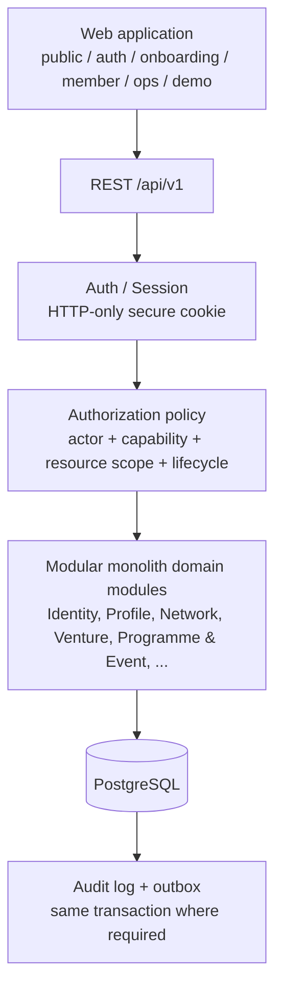

# 1hub.network

1hub.network is a shared ecosystem identity, data and operating layer for the HUB network:
HUB, Chapters, Clubs (CLB), members, programmes, events and projects/startups. Community,
programme and event activity is recorded as canonical structured data that continuously
enriches one profile per person and per project, instead of living in per-programme silos.

This repository contains the **Phase 0 (P0)** implementation and its frozen source-of-truth pack.

> This README is an **entry point**, not a source of truth. When it disagrees with a frozen
> SOT document, the SOT wins. See [Source of truth](#9-source-of-truth).

---

## 1. Product overview

1hub.network is not a profile website. It connects:

- **identity**: one account and one root profile per person;
- **organization/network data**: HUB, Chapter, CLB, companies, funds, partners and the
  memberships, leadership terms and representations that link people to them;
- **activity**: programmes, challenges, events and projects/startups;
- **history**: outcomes and participation linked back to canonical profiles.

```text
Community / Programme / Event activity
                ↓
       canonical structured records
                ↓
Individual / Project / Startup / Solution profiles
                ↓
      continuously enriched history
                ↓
      future Discovery / Matching
```

Source: [Master Spec §1](1HUB_IMPLEMENTATION_MASTER_SPEC_v1.3.md).

## 2. Why it exists

The architecture exists to prevent the ecosystem's data from fragmenting. From the frozen SOT:

| Problem it prevents | SOT rule |
|---|---|
| Programme-owned spreadsheets and data copies | "must never reduce this to isolated programme-owned spreadsheets/data copies" ([System Arch §8](docs/architecture/01_SYSTEM_ARCHITECTURE_v1.0.md)) |
| People re-entering the same profile per programme | One individual → one root profile; applications reference it, never duplicate it ([Data SOT §1](docs/product/1HUB_DATA_SOT_v1.1.md)) |
| Projects re-created per programme | Project/Startup is canonical and reused in WF05 ([WF02](docs/workflows/WF02_MEMBER_PROFILE_NETWORK_FINAL_v1.0.md)) |
| Activity/outcomes that never accumulate | Programme/event activity links back to Individual/Project, not to copies |
| Unfilterable free-text taxonomy | REGION/DOMAIN/SKILL use controlled vocabularies |

The narrative Business SOT (BA problem statement) is referenced as frozen but is **not stored
in this repository**; the table above cites only documents that are.

## 3. Phase 0 scope

### Production
- **WF01** — Identity & Onboarding
- **WF02** — Member Profile & Network Management
- **WF03** — HUB / Chapter / CLB Operations (Production/Internal)

### Demo
- **WF04** — Programme / Challenge Operations (business happy path frozen; demo design tracked separately)
- **WF05** — Project / Startup Journey (reuses the WF02 Project/Startup entity)

### Future
- **WF06** — Ecosystem Data / Discovery / Matching (read-model architecture only)
- Investor / VC / Dataroom flows

**Demo and Future scope must not silently become Production implementation.** Demo data is
deterministic and isolated from Production write paths; promotion requires explicit authorization.

## 4. Workflow map

| Workflow | Purpose | P0 mode |
|---|---|---|
| WF01 | Auth entry → magic link → onboarding (purpose, profile, privacy) → WF02 | Production |
| WF02 | Account home, profile edit, privacy/visibility, roles & network links, project/startup profile + team, settings | Production |
| WF03 | Scoped unit ops: dashboard, members, programme list, content, **Event Management**, settings, public unit page | Production/Internal |
| WF04 | Programme/Challenge create → configure → publish → monitor | Demo |
| WF05 | Project/Startup journey on the canonical WF02 project | Demo |
| WF06 | Ecosystem data flywheel, discovery, matching | Future |

Screen-level contracts: [WF01](docs/workflows/WF01_IDENTITY_ONBOARDING_FINAL_v1.0.md) ·
[WF02](docs/workflows/WF02_MEMBER_PROFILE_NETWORK_FINAL_v1.0.md) ·
[WF03](docs/workflows/WF03_HUB_CHAPTER_CLB_OPERATIONS_FINAL_v1.0.md) ·
[WF04 reference](docs/design/WF04_EXTERNAL_REFERENCE.md).

## 5. High-level architecture

**Logical architecture** (frozen): a **modular monolith** backend with explicit domain
boundaries, one PostgreSQL database, versioned REST `/api/v1`, and one web app with route
groups. Not microservices.



Also in the logical design: S3-compatible object storage, a transactional email provider and
analytics, with external side effects dispatched from the outbox. Details:
[System Architecture](docs/architecture/01_SYSTEM_ARCHITECTURE_v1.0.md),
[Domain Architecture](docs/architecture/02_DOMAIN_ARCHITECTURE_v1.0.md).

**Current implementation** (M0): a single Next.js App Router project hosts both the web route
groups and the `/api/v1` route handlers. Domain modules, auth, RBAC, audit and outbox are
**not implemented yet**; see [Current status](#15-current-status).

## 6. Domain architecture

These boundaries are the core of the model. README summarizes; the
[Data SOT](docs/product/1HUB_DATA_SOT_v1.1.md) and
[Data Decisions Freeze](docs/product/00_DATA_DECISIONS_FREEZE_v1.1.md) define.

```text
UserAccount  ≠  IndividualProfile  ≠  IdentityVerification

IndividualProfile (one per UserAccount)
  ├── ConsentRecord              versioned; separate from visibility
  ├── ProfileVisibilitySetting   per data group
  ├── CommunityMembership        ACTIVE only after valid confirmation
  ├── LeadershipRecord           separate from membership; keeps term history
  ├── OrganizationRepresentation
  └── RoleAssignment             role + scope + validity; a badge grants nothing
```

| Concept | Rule |
|---|---|
| Organization types | `HUB`, `CHAPTER`, `CLB`, `COMPANY`, `FUND`, `PARTNER` |
| Project / Startup | Canonical entity, reusable across workflows and programmes |
| Programme / Challenge | One `Programme` aggregate with `programme_type = PROGRAMME \| CHALLENGE` |
| Event | Canonical; standalone or linked to a Programme |
| Membership | Self-selection never auto-creates ACTIVE membership; P0 uses preseeded roster + pending fallback |
| Profile completion | Server-derived from the frozen 10 groups × 10%; clients never submit a percent |
| Taxonomy | REGION / DOMAIN / SKILL are controlled-vocabulary IDs |
| History | Ended/archived by state, not hard-deleted once activity exists |

## 7. Authorization & security model

**Frontend route separation is not a security boundary.** Route guards exist for UX only.

Every protected server operation checks:

```text
actor identity + role/capability + resource scope + lifecycle rule
```

- Browser session uses a secure, HTTP-only cookie.
- Role or scope is never trusted from local storage or the frontend route.
- Visibility, consent and relationship filters are applied server-side **before** serialization.
- APIs return DTOs, never raw persistence rows.
- Sensitive mutations (role, membership, consent, visibility, representation) emit audit events.
- Errors use the frozen error envelope; no stack traces or private data leak.
- Future 1Hub SSO / VNeID verification sits behind an identity-provider boundary.

Sources: [Auth/RBAC Architecture](docs/architecture/03_AUTH_RBAC_ARCHITECTURE_v1.0.md),
[API Contract](docs/architecture/05_API_CONTRACT_P0_v1.0.md).

## 8. Repository structure

Actual layout (generated folders such as `node_modules/` and `.next/` omitted):

```text
.
├── CLAUDE.md                         Repository rules for AI implementation agents
├── 1HUB_IMPLEMENTATION_MASTER_SPEC_v1.3.md   Implementation master spec
├── docs/
│   ├── product/                      Data SOT + Data Decisions Freeze
│   ├── workflows/                    WF01–WF03 workflow contracts
│   ├── design/                       Design Pixel SOT, screen map/contracts, tokens
│   ├── architecture/                 System, domain, auth/RBAC, frontend/API, API contract, DB schema
│   ├── qa/                           Pixel QA architecture
│   └── implementation/               Master prompt, latest report, gap/decision memos, reports/
├── design-reference/
│   ├── final/                        APPROVED pixel baseline (read-only) + manifest
│   └── source-thao/                  Immutable raw source evidence (not implementation SOT)
├── db/
│   ├── migrations/                   001_p0_init.sql (frozen)
│   └── seed/                         seed_dev.sql, roster import template, SEED_README
├── src/
│   ├── app/                          Next.js App Router
│   │   ├── (public) (auth) (onboarding) (member) (ops)   route groups
│   │   ├── api/v1/                   REST route handlers
│   │   └── dev/                      dev-only harness pages (ENABLE_DEV_ROUTES=1)
│   ├── components/{shell,ui}/        App shell and shared UI primitives
│   ├── lib/api/                      API client, error envelope, handler, request id, idempotency
│   ├── lib/db/                       PostgreSQL client + DB integration tests
│   └── styles/                       Design tokens, fonts, primitives CSS
├── tests/visual/                     Playwright harness: specs/, baseline/ (harness-owned)
├── scripts/                          db.mjs (DB lifecycle), sync-fonts.mjs
├── public/fonts/                     Self-hosted font files
└── compose.yaml                      Local PostgreSQL container
```

Logical vs current: the frozen design has separate Web and API deployables and a `/demo/*`
route group. Today both live in one Next.js project, and no `(demo)` routes exist yet (WF04/WF05
are later milestones). Most route pages are M0-T03 placeholders bound to the frozen route manifest.

## 9. Source of truth

Precedence from [CLAUDE.md](CLAUDE.md) §1. If sources conflict, stop and report; do not guess.

| Rank | Source | Files |
|---|---|---|
| 1 | Business SOT / workflow docs | [docs/workflows/](docs/workflows/) |
| 2 | Data SOT + data freeze | [Data SOT](docs/product/1HUB_DATA_SOT_v1.1.md), [Data Decisions Freeze](docs/product/00_DATA_DECISIONS_FREEZE_v1.1.md) |
| 3 | Design Pixel SOT + screen contracts | [Design Pixel SOT](docs/design/00_DESIGN_PIXEL_SOT_FINAL_v1.0.md), [Screen Map](docs/design/01_SCREEN_MAP_WF01_WF03_FINAL_v1.0.md), [Screen Contracts](docs/design/SCREEN_CONTRACTS_WF01_WF03_v1.0.yaml), [manifest](design-reference/final/manifest.yaml) |
| 4 | Architecture + API contract | [docs/architecture/](docs/architecture/), [API Contract](docs/architecture/05_API_CONTRACT_P0_v1.0.md) ([YAML](docs/architecture/05_API_CONTRACT_P0_v1.0.yaml)), [DB Schema](docs/architecture/06_DB_SCHEMA_P0_v1.0.md) |
| 5 | Repository rules | [CLAUDE.md](CLAUDE.md), [Master Spec](1HUB_IMPLEMENTATION_MASTER_SPEC_v1.3.md) |
| 6 | Existing code | `src/`, `db/` |

QA: [Pixel QA Architecture v1.1](docs/qa/05_PIXEL_QA_ARCHITECTURE_v1.1.md) (v1.0 is kept for history).

**`design-reference/final` is the approved visual baseline.** Raw historical design exports
(`design-reference/source-thao/`) are evidence only, not the implementation source of truth.

## 10. Design & visual QA

| Rule | Value |
|---|---|
| Default UI font | Be Vietnam Pro |
| Secondary fonts | Archivo Bold (display), IBM Plex Mono Medium (meta) — only where the Design SOT approves |
| Identity | 1hub red/burgundy; APEC blue is not imported |
| Viewport | 1440×900, DPR1; long pages scroll (`__full.png` references), never squashed |
| Browser automation | Playwright (Chromium) is authoritative ([rule](docs/implementation/browser-testing-rule.md)); browser extensions or manual clicks are not evidence |
| Approved baseline | `design-reference/final/` — read-only |
| Harness baseline | `tests/visual/baseline/` — test-harness regression data, **not** an approved design baseline |

Never overwrite a baseline to hide a mismatch, and never redesign an approved screen to ease
implementation. Screen loop:

```text
Implement → Functional test → Playwright → Screenshot → Pixel diff → Fix
  → Re-capture → Regression → Commit → STOP
```

Mismatches are classified structural / major / component / raster noise / intentional
(see Pixel QA §6). Manifest-driven pixel comparison against `design-reference/final` is planned
for M0-T11; today the harness covers foundation specs only.

## 11. Testing strategy

Commands that exist in [package.json](package.json):

| Area | Command | Notes |
|---|---|---|
| Format | `pnpm format:check` / `pnpm format` | Prettier; frozen SOT pack is ignored |
| Lint | `pnpm lint` | ESLint (next config) |
| Typecheck | `pnpm typecheck` | `tsc --noEmit` |
| Unit / integration | `pnpm test` | Vitest, `src/**/*.test.ts(x)`; hermetic, no Docker |
| DB integration | `pnpm test:db` | Vitest, `src/**/*.db-test.ts`; needs running DB and `DATABASE_URL` exported |
| Build | `pnpm build` | Next.js production build |
| Playwright / visual | `pnpm visual` | Serves the production build (`pnpm build` first) at 1440×900 DPR1 |
| Visual report | `pnpm visual:report` | Opens the last HTML report |
| Full gate | `pnpm verify` | format:check + lint + typecheck + test + build |
| Full gate + visual | `pnpm verify:visual` | `verify` then `visual` |

`pnpm visual:update` rewrites **harness** baselines only; use it solely for an intentional,
reviewed change. There is no markdown linter or workflow E2E suite configured yet.

## 12. Local development

Prerequisites (from `package.json`, `mise.toml`, `.nvmrc`, `compose.yaml`):

- Node.js 22 (`engines: >=22 <23`, `engine-strict=true`)
- pnpm 11 (`packageManager: pnpm@11.23.0`)
- Docker with Compose (PostgreSQL 17.6 container on host port **55432**)
- Playwright Chromium, for the visual suite

```bash
# 1. Tooling (optional if Node 22 + pnpm 11 are already installed)
mise install

# 2. Dependencies
pnpm install
pnpm exec playwright install chromium    # only for `pnpm visual`

# 3. Environment: copy the template and fill in local values
cp .env.example .env.local
#   DATABASE_URL=postgresql://<user>:<password>@localhost:55432/<db>
#   ENABLE_DEV_ROUTES=1                   # dev-only harness routes; never in production

# 4. Database: start container, apply migrations, load dev seed
pnpm db:setup            # = db:up + db:migrate + db:seed
pnpm db:status           # check applied migrations

# 5. Run
pnpm dev                 # http://localhost:3000

# 6. Verify
pnpm verify
```

Other DB commands: `db:down`, `db:destroy` (drops the volume), `db:reset`, `db:introspect`.
`scripts/db.mjs` reads `DATABASE_URL` from the shell environment (falling back to the local
compose defaults); it does not read `.env.local`. Never commit real secrets.

## 13. Database

- PostgreSQL is the single primary database; schema reference is
  [DB Schema P0](docs/architecture/06_DB_SCHEMA_P0_v1.0.md).
- Migrations in `db/migrations/` are authoritative implementation artifacts, applied in one
  transaction and tracked by sha256 in a `schema_migrations` ledger.
- `001_p0_init.sql` must **never** be rewritten once applied; approved changes go in new,
  additive, numbered migrations.
- `seed_dev.sql` is development/QA data; its target is a deterministic, idempotent fixture with
  fixed IDs. Real HUB roster data is imported separately via
  `db/seed/production_roster_template.csv`; production Chapter/CLB names are never invented.

**Known open items.** M0-T06A found schema/SOT compatibility gaps (the current seed is not yet
deterministic; RoleAssignment and several lifecycle states in migration 001 lag the Data SOT).
They are recorded, not resolved, in:
[DB_SCHEMA_GAPS_P0.md](docs/implementation/DB_SCHEMA_GAPS_P0.md) and the local decision memo
[P0_DECISIONS_REQUIRED.md](docs/implementation/P0_DECISIONS_REQUIRED.md) (under review).

## 14. Implementation workflow

```text
SOT → Task authorization → Claude implementation → Validation
    → Playwright / Pixel QA → Regression → Local report
    → Human / ChatGPT review → Next task
```

- One authorized task or screen at a time; STOP at the end of each.
- Every task reports in [CLAUDE_LATEST_REPORT.md](docs/implementation/CLAUDE_LATEST_REPORT.md)
  and archives it under [reports/](docs/implementation/reports/).
- Commit/push rules are defined in [CLAUDE.md](CLAUDE.md) §11–12; a task may run in
  local-review mode (no push) when its authorization says so.

Milestones ([Master Spec §9](1HUB_IMPLEMENTATION_MASTER_SPEC_v1.3.md)): **M0** Foundation →
**M1** WF01 → **M2** WF02 → **M3** WF03 → **M4** WF04 Demo → **M5** WF05 Demo → **M6** WF06 Future.

Gates:

```text
M0 Completion Audit → WF01 Completion Audit → WF02 Completion Audit
  → WF03 Completion Audit → P0 Local Completion Audit → UAT → Go-live
```

## 15. Current status

Factual state from [reports/](docs/implementation/reports/) and git history:

| Item | State |
|---|---|
| Phase | **M0 — Foundation** |
| Done (committed) | M0-T01 repo bootstrap · M0-T02/T02b fonts, tokens, Playwright typography · M0-T03 shell + frozen route groups · M0-T04 UI primitives · M0-T05 API client + error envelope · M0-T06A PostgreSQL foundation + schema audit · OPS-GH01 GitHub handoff |
| Not yet built | Deterministic seed (M0-T07), auth/session (M0-T08), RBAC (M0-T09), idempotency store (M0-T10), manifest-driven pixel harness (M0-T11), all WF screens |
| `GET /api/v1/session` | Contract shape only; always `{authenticated:false}` until a session store exists |
| Open decisions | Schema/SOT gaps B1–B5 classified locally in [P0_DECISIONS_REQUIRED.md](docs/implementation/P0_DECISIONS_REQUIRED.md); pending review |
| Next task | Waiting for review and authorization |

Latest report: [docs/implementation/CLAUDE_LATEST_REPORT.md](docs/implementation/CLAUDE_LATEST_REPORT.md).

## 16. Non-goals / guardrails

- No microservice rewrite, Kafka, external policy engine, search cluster or AI matching engine in P0.
- No Future (WF06, investor/dataroom) implementation in P0.
- No invented business rules, enums, statuses, routes or permissions to fill UI gaps.
- No frontend-only authorization.
- No copying canonical profile/project data per programme.
- No modifying `design-reference/final` or overwriting baselines to make pixel tests pass.
- No refactoring unrelated modules during a scoped task.

## 17. Documentation map

| Group | Location |
|---|---|
| Product / Data | [docs/product/](docs/product/) |
| Workflows | [docs/workflows/](docs/workflows/) |
| Design | [docs/design/](docs/design/), [design-reference/final/](design-reference/final/README.md) |
| Architecture | [docs/architecture/](docs/architecture/) |
| QA | [docs/qa/](docs/qa/), [browser-testing-rule.md](docs/implementation/browser-testing-rule.md) |
| Implementation | [Master prompt](docs/implementation/CLAUDE_MASTER_PROMPT_P0_v1.0.md), [readiness](docs/implementation/READY_FOR_CLAUDE_P0.md), [reports/](docs/implementation/reports/) |
| Seed / DB | [SEED_README.md](db/seed/SEED_README.md), [db/migrations/](db/migrations/) |
