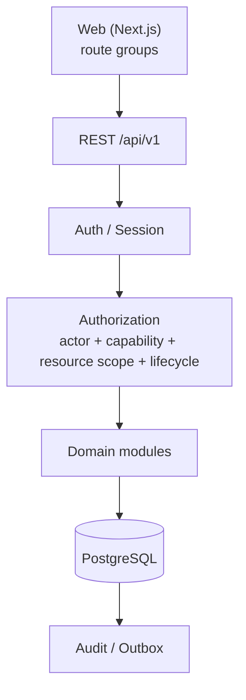

# 1hub.network

Shared identity, data and operating layer cho HUB ecosystem. Repository này chứa web application
**Phase 0 (P0)** và bộ source of truth (SOT) đã frozen.

> README chỉ là entry point, **không phải nguồn authoritative**. Khi README khác với frozen SOT,
> SOT thắng. Xem [mục 6](#6-source-of-truth--đọc-tài-liệu-nào-trước).

---

## 1. Project Overview / 1hub.network là gì?

1hub.network kết nối các canonical record của hệ sinh thái:

- people / identity;
- HUB / Chapter / CLB / organization;
- programmes / challenges;
- events;
- projects / startups;
- participation / outcomes.

**Core idea:** canonical, reusable record thay vì bản copy riêng cho từng programme. Mỗi hoạt động
làm giàu thêm một profile duy nhất cho mỗi người và mỗi project.

Vấn đề cần giải quyết:

- dữ liệu phân tán trên Form / Sheet / Drive;
- member và project phải nhập lại cùng thông tin cho mỗi programme;
- activity / outcome không tích lũy thành profile tái sử dụng được.

## 2. P0 Scope / P0 đang build gì?

| Workflow | Purpose | P0 mode |
|---|---|---|
| WF01 — Identity & Onboarding | Account access, profile ban đầu, consent và visibility | Production |
| WF02 — Member Profile & Network | Profile, privacy, roles/network links, project/startup profile và team | Production |
| WF03 — HUB / Chapter / CLB Operations | Vận hành theo scope: members, programmes, content, events, settings | Production/Internal |
| WF04 — Programme / Challenge Operations | Tạo, cấu hình, publish và theo dõi programme | Demo |
| WF05 — Project / Startup Journey | Journey trên canonical project của WF02 | Demo |
| WF06 — Ecosystem Data / Discovery / Matching | Read model, discovery, matching | Future |

**Demo and Future scope must not silently become Production.** Investor / VC / Dataroom cũng là Future.

Workflow contracts: [WF01](docs/workflows/WF01_IDENTITY_ONBOARDING_FINAL_v1.0.md) ·
[WF02](docs/workflows/WF02_MEMBER_PROFILE_NETWORK_FINAL_v1.0.md) ·
[WF03](docs/workflows/WF03_HUB_CHAPTER_CLB_OPERATIONS_FINAL_v1.0.md)

## 3. System Architecture / Kiến trúc hệ thống

Logical architecture:



Request flow map vào source:

```text
src/app/(route groups)     page / UI
  → src/lib/api            API client, error envelope
  → src/app/api/v1         REST API handler
  → Session / Auth
  → Authorization          actor + capability + resource scope + lifecycle
  → Domain logic
  → src/lib/db             PostgreSQL client
  → PostgreSQL
```

- Backend là **modular monolith**, không phải microservices.
- **PostgreSQL** là database chính duy nhất.
- **Versioned REST** dưới `/api/v1`, dùng frozen error envelope.
- Hiện tại **một Next.js app** host cả Web lẫn API.
- **Frontend route không phải security boundary**; route guard chỉ phục vụ UX.
- **Server là authoritative** cho authorization, lifecycle và data filtering.

**Logical architecture ≠ current source layout.** Domain boundaries là khái niệm kiến trúc đã
frozen, nhưng không phải logical domain module nào cũng đã có source folder riêng.
Chi tiết: [docs/architecture/](docs/architecture/).

## 4. Source Architecture / Source tổ chức thế nào?

Cấu trúc thực tế (bỏ qua `node_modules/`, `.next/`):

```text
.
├── CLAUDE.md                  Rule cho AI implementation agent
├── 1HUB_IMPLEMENTATION_MASTER_SPEC_v1.3.md
├── src/
│   ├── app/                   Next.js App Router
│   │   ├── (public) (auth) (onboarding) (member) (ops)   UI route groups
│   │   ├── api/v1/            REST API handlers
│   │   └── dev/               Harness page chỉ dùng khi dev (ENABLE_DEV_ROUTES=1)
│   ├── components/
│   │   ├── shell/             App shell, page container
│   │   └── ui/                Shared UI primitives
│   ├── lib/
│   │   ├── api/               API client, error envelope, handler, request id
│   │   └── db/                PostgreSQL client và DB integration test
│   └── styles/                Design tokens, fonts, primitives CSS
├── db/
│   ├── migrations/            Numbered SQL migration, chỉ thêm mới (additive)
│   └── seed/                  Deterministic fixture và template import roster
├── tests/visual/              Playwright harness: specs/, baseline/
├── design-reference/
│   ├── final/                 Approved pixel baseline + manifest (read-only)
│   └── source-thao/           Source evidence gốc, không phải SOT
├── docs/
│   ├── product/               Data SOT + data decisions freeze
│   ├── workflows/             Workflow contracts WF01–WF03
│   ├── design/                Pixel SOT, screen map/contracts, design tokens
│   ├── architecture/          System, domain, auth/RBAC, frontend/API, API contract, DB schema
│   ├── qa/                    Pixel QA architecture
│   └── implementation/        Status, task report, decision/gap memo
├── scripts/                   db.mjs (DB lifecycle), sync-fonts.mjs
├── public/fonts/              Font self-hosted
└── compose.yaml               PostgreSQL container cho local
```

Unit test đặt cạnh code (`*.test.ts`, `*.db-test.ts`); Playwright spec nằm trong `tests/visual/specs/`.

### Where should new code go? / Code mới đặt ở đâu?

| Concern | Location |
|---|---|
| Page / route | `src/app/` trong route group tương ứng |
| REST endpoint | `src/app/api/v1/` |
| Reusable UI | `src/components/ui/` |
| Shared shell / layout | `src/components/shell/` |
| API / client infrastructure | `src/lib/api/` |
| Database access | `src/lib/db/` |
| Domain module | Logical domain boundary only; current implementation remains under the existing source structure |
| Migration | `db/migrations/` (file mới, đánh số tiếp theo) |
| Deterministic fixture | `db/seed/` |
| Playwright / visual test | `tests/visual/` |
| Approved design baseline | `design-reference/final/` (read-only) |
| Product / Data / Design / Architecture SOT | `docs/` (frozen; không sửa khi chưa được authorize) |

## 5. Core Engineering Rules / Rule không được phá

```text
UserAccount  ≠ IndividualProfile ≠ IdentityVerification
Membership   ≠ Leadership ≠ OrganizationRepresentation ≠ RoleAssignment
Consent      ≠ Visibility
Authorization = actor + capability + resource scope + lifecycle
```

- Project / Startup là canonical và reusable; không copy theo từng programme.
- Programme / Challenge dùng một `Programme` aggregate với subtype.
- Event là canonical; có thể standalone hoặc link với Programme.
- Profile completion do server tính; client không bao giờ gửi percent.
- REGION / DOMAIN / SKILL là controlled vocabulary ID.
- Frontend route không phải security; server là authoritative.
- API trả DTO, không trả raw DB row.
- Visibility / consent filtering chạy server-side, trước serialization.
- Sensitive mutation → audit event.
- Không tự bịa business rule, status, route hay permission còn thiếu.
- Migration đã apply thì không bao giờ rewrite; thay đổi đi bằng additive migration.

Định nghĩa đầy đủ: [Data SOT](docs/product/1HUB_DATA_SOT_v1.1.md).

## 6. Source of Truth / Đọc tài liệu nào trước?

Frozen precedence (giống hệt [CLAUDE.md §1](CLAUDE.md)):

1. [CLAUDE.md](CLAUDE.md)
2. [1HUB_IMPLEMENTATION_MASTER_SPEC_v1.3.md](1HUB_IMPLEMENTATION_MASTER_SPEC_v1.3.md)
3. Workflow contracts — [WF01](docs/workflows/WF01_IDENTITY_ONBOARDING_FINAL_v1.0.md),
   [WF02](docs/workflows/WF02_MEMBER_PROFILE_NETWORK_FINAL_v1.0.md),
   [WF03](docs/workflows/WF03_HUB_CHAPTER_CLB_OPERATIONS_FINAL_v1.0.md)
4. Data SOT — [1HUB_DATA_SOT_v1.1.md](docs/product/1HUB_DATA_SOT_v1.1.md),
   [00_DATA_DECISIONS_FREEZE_v1.1.md](docs/product/00_DATA_DECISIONS_FREEZE_v1.1.md)
5. Design SOT — [Design Pixel SOT](docs/design/00_DESIGN_PIXEL_SOT_FINAL_v1.0.md),
   [Screen Map](docs/design/01_SCREEN_MAP_WF01_WF03_FINAL_v1.0.md),
   [Screen Contracts](docs/design/SCREEN_CONTRACTS_WF01_WF03_v1.0.yaml),
   [Design Tokens](docs/design/DESIGN_TOKENS_v1.0.css),
   [manifest.yaml](design-reference/final/manifest.yaml), `design-reference/final/**`
6. Architecture — [docs/architecture/](docs/architecture/)
7. DB migrations / deterministic fixtures — [db/migrations/](db/migrations/), [db/seed/](db/seed/)
8. QA / Pixel QA rules — [Pixel QA Architecture v1.1](docs/qa/05_PIXEL_QA_ARCHITECTURE_v1.1.md)
9. Existing repository code and conventions

Khi các nguồn mâu thuẫn: làm theo precedence ở trên, **không tự ý reconcile**; dừng lại và report.

- `design-reference/final/**` = approved visual implementation baseline.
- `design-reference/source-thao/**` = source evidence / history, không phải implementation SOT.

## 7. Local Setup / Chạy local

Prerequisites: Node.js 22, pnpm 11 (pin trong `mise.toml`), Docker Compose, Playwright Chromium.

```bash
pnpm install
pnpm exec playwright install chromium   # chỉ cần cho visual suite
cp .env.example .env.local              # điền giá trị local
pnpm db:setup                           # start PostgreSQL, migrate, seed
pnpm dev                                # http://localhost:3000
```

- PostgreSQL chạy trong Docker ở host port `55432` (`compose.yaml`).
- `scripts/db.mjs` và `pnpm test:db` đọc `DATABASE_URL` từ shell, không đọc `.env.local`.
- Không bao giờ commit secret.

## 8. Testing & Visual QA / Test thế nào?

| Purpose | Command |
|---|---|
| Format | `pnpm format:check` |
| Lint | `pnpm lint` |
| Typecheck | `pnpm typecheck` |
| Unit / integration | `pnpm test` |
| DB integration (cần DB đang chạy) | `pnpm test:db` |
| Build | `pnpm build` |
| Playwright visual suite (sau `pnpm build`) | `pnpm visual` |
| Full verify | `pnpm verify` (format, lint, typecheck, test, build) |
| Full verify + visual | `pnpm verify:visual` |

Visual QA rules:

- Playwright Chromium là authoritative ([browser-testing rule](docs/implementation/browser-testing-rule.md)).
- Capture ở **1440×900, DPR1** với deterministic data / state.
- `design-reference/final/` là approved pixel baseline, read-only.
- `tests/visual/baseline/` là harness regression baseline, không phải approved design.
- Không bao giờ sửa approved design baseline để test pass.

```text
Implement → Functional test → Playwright → Screenshot → Pixel diff → Fix → Regression → STOP
```

## 9. Development Workflow / Quy trình implement

```text
SOT → Authorized task → Implement → Validation → Playwright / Pixel QA
  → Regression → Report → ChatGPT / Human review → Next task
```

- Mỗi lần chỉ một authorized task; STOP sau khi xong task.
- Latest report: [CLAUDE_LATEST_REPORT.md](docs/implementation/CLAUDE_LATEST_REPORT.md)
- Current status: [P0_STATUS.md](docs/implementation/P0_STATUS.md)

Milestone gates: M0 Audit → WF01 Audit → WF02 Audit → WF03 Audit → P0 Local Completion Audit
→ UAT → Go-live.
