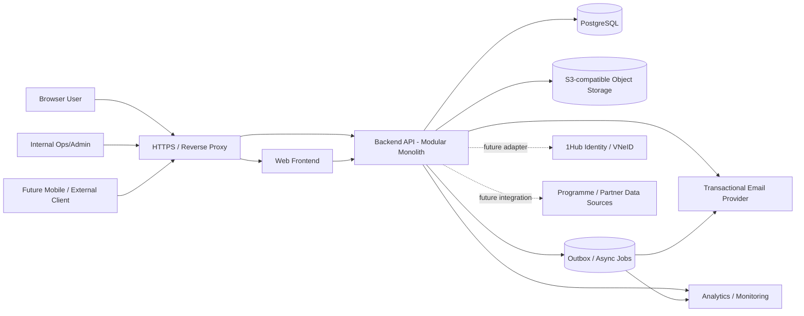
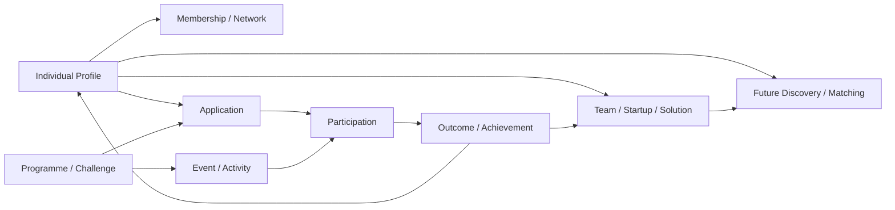

# 1HUB.NETWORK — SYSTEM ARCHITECTURE v1.0

**Status:** READY FOR IMPLEMENTATION FOUNDATION (M0)  
**Date:** 25/09/2026  
**Architecture style:** Modular monolith + shared relational data store + explicit domain boundaries.

---

## 1. Architecture goals

1. Ship P0 quickly without creating throwaway architecture.
2. Keep one canonical identity/profile across web now and future app/API consumers.
3. Keep Programme/Event/Project data linkable back to canonical profiles.
4. Enforce auth/RBAC/consent on the server; frontend is never a security boundary.
5. Preserve auditability and provenance from day one.
6. Allow WF04/WF05 to begin as deterministic Demo data and become real backend workflows later without redesigning the frontend shell or canonical IDs.
7. Support pixel-to-pixel UI implementation independently of backend/domain evolution.

---

## 2. Chosen architecture

### Decision
Use a **modular monolith** for the API/backend in v1, not microservices.

Reasons:
- P0 is deadline-driven and domain boundaries are still evolving.
- Cross-domain consistency is important: Account/Profile/Role/Consent/Membership/Programme records must remain transactionally consistent.
- A small team + AI coding benefits from one deployable backend with strict modules more than distributed infrastructure.
- Domain events/outbox keep later service extraction possible.

### Logical deployment



---

## 3. Deployable components

### 3.1 Web Frontend
Responsibilities:
- public landing and public entity pages;
- authenticated member workspace;
- internal Ops/Admin workspace;
- Demo views for WF04/WF05;
- route guards for UX only;
- deterministic visual-test scenarios.

The web app never decides final authorization.

### 3.2 Backend API — Modular Monolith
Responsibilities:
- authentication/session resolution;
- all business rules/state transitions;
- RBAC/scope/consent enforcement;
- persistence and transactions;
- audit log;
- notification/event generation;
- analytics event generation;
- file access authorization.

Domain modules are defined in `02_DOMAIN_ARCHITECTURE_v1.0.md`.

### 3.3 PostgreSQL
Use one physical database in v1, with clear module ownership of tables.

Rules:
- FK constraints for canonical relationships;
- soft archive for historical business records;
- append-only audit log;
- transactional outbox for external side effects;
- no per-workflow duplicate profile tables.

### 3.4 Object Storage
Use S3-compatible object storage for:
- avatar;
- organization logo/banner;
- public programme media;
- later restricted documents.

Private assets use time-limited/presigned access after API authorization. Never use permanent public links for restricted content.

### 3.5 Email / Notification
P0 requires transactional email. In-app notification is supported by the platform model, but P0 implementation can be limited to flows actually exposed in Production.

Notification writes are generated from domain events/state changes rather than directly from UI code.

### 3.6 Analytics / Monitoring
P0 minimum product events:
- registration completed;
- profile completion changed / >=80 achieved;
- feedback submitted;
- onboarding step funnel;
- errors affecting auth/profile/consent.

Operational monitoring must also capture permission failures, API errors and integration failures.

---

## 4. Environment topology

```text
LOCAL
  Web + API + PostgreSQL + local object storage/emulator

STAGING
  Production-like configuration
  deterministic QA seed
  visual regression target

PRODUCTION
  Web
  API
  PostgreSQL
  object storage
  email provider
  monitoring/analytics
```

No direct production DB access from the frontend.

---

## 5. Request path

```text
Browser
  ↓ HTTPS
Web App
  ↓ /api/v1/*
API
  ↓ Session/Auth resolution
Authorization Policy
  ↓
Domain Application Service
  ↓
Repository / Transaction
  ↓
PostgreSQL
  ↓
Audit + Outbox in same transaction where required
```

External side effects (email/analytics) occur from outbox processing so core business transactions do not fail solely because an external provider is unavailable.

---

## 6. Auth architecture boundary

P0 auth provider is abstracted behind the Identity domain.

```text
UserAccount
  ├── LocalCredential / current auth       [P0]
  └── ExternalIdentity                     [future]
          └── 1Hub / VNeID adapter
```

Identity verification is **not** the same object as Account or IndividualProfile.

A 1Hub/VNeID outage in the future must not invalidate an existing 1hub.network account/profile.

---

## 7. Production vs Demo isolation

### Production 29/09
- WF01 Identity & Onboarding
- WF02 Member Profile & Network
- minimal WF03 Internal Ops

### Demo 29/09
- WF04 Programme/Challenge
- WF05 Project/Startup

Demo data must be deterministic and clearly isolated from Production write paths. Recommended implementation:

```text
/demo/* routes
  → read-only seeded API responses or fixture repository
```

Do not introduce fake demo records into real user production data tables unless they are explicitly tagged and isolated.

### Future
- WF06 discovery/matching/intelligence
- investor/dataroom flows

---

## 8. Data/event flow that preserves the product advantage



The architecture must never reduce this to isolated programme-owned spreadsheets/data copies.

---

## 9. Non-functional baseline

- HTTPS only in non-local environments.
- HTTP-only secure cookie/session for web auth.
- Server-side authorization on every protected action.
- Audit all role/membership/consent/visibility changes.
- Standard UTC storage + explicit display timezone.
- Paginate large lists/logs.
- Structured error codes; no leaking stack traces or private data.
- Backup and restore PostgreSQL/object storage.
- Central application logs + request correlation ID.
- File validation and size/type limits.
- Rate limiting on auth, email verification and sensitive endpoints.

---

## 10. Explicit non-goals for P0 architecture

Do not add:
- microservices;
- event streaming platform/Kafka;
- external policy engine/OPA;
- Elasticsearch/OpenSearch;
- AI matching engine;
- full CRM/LMS/ERP;
- investor transaction processing;
- full programme judging engine;
- real-time collaboration stack.

These may be introduced only when a validated workflow requires them.

---

## 11. SA decision summary

| Area | Decision |
|---|---|
| Backend style | Modular monolith |
| Primary DB | PostgreSQL |
| File storage | S3-compatible |
| Web/API boundary | Separate Web UI and shared `/api/v1` backend |
| Auth | Provider abstraction; P0 current/local auth; 1Hub/VNeID later |
| Authorization | Server-side role + scope + relationship + consent policy |
| Async | Transactional outbox / lightweight worker |
| Analytics | P0 funnel + operational monitoring |
| Demo | Isolated deterministic fixture/seed paths |
| Future extraction | Domain modules + events make extraction possible |

