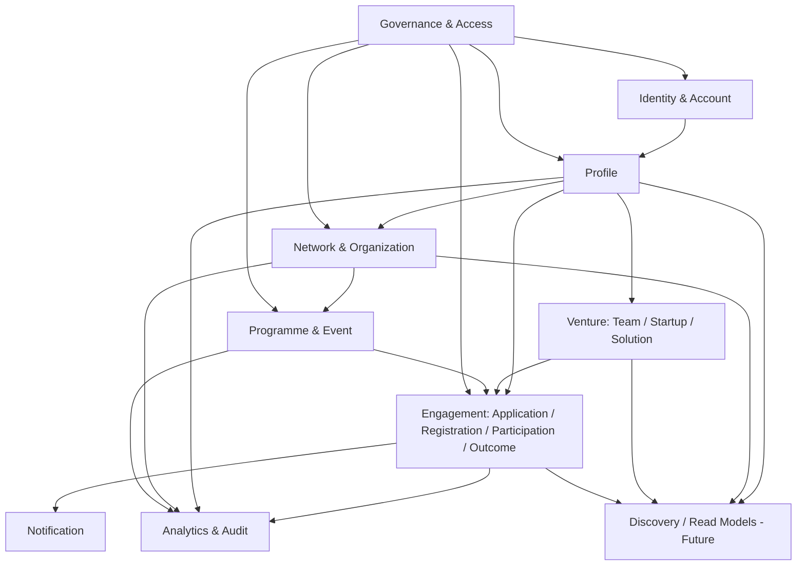

# 1HUB.NETWORK — DOMAIN ARCHITECTURE v1.0

**Status:** FROZEN FOR M0/M1  
**Style:** Domain-oriented modular monolith.

---

## 1. Domain map



---

## 2. Bounded modules

### 2.1 Identity & Account
Owns:
- `UserAccount`
- login identity / credential binding
- email verification state
- future `ExternalIdentity`
- session lifecycle

Does **not** own:
- profile bio/skills;
- HUB membership;
- role badges;
- VNeID document data.

Public service examples:
- `registerAccount`
- `verifyEmail`
- `authenticate`
- `linkExternalIdentity`

---

### 2.2 Profile
Owns:
- `IndividualProfile`
- profile sections and completion score
- controlled-value links: region/domain/skill
- experience items
- goal/need
- profile visibility preferences

Invariants:
- one canonical profile per account/person;
- completion is derived, never manually stored as arbitrary editable value;
- visibility is separate from verification and membership.

---

### 2.3 Network & Organization
Owns:
- `Organization`
- `OrganizationRelationship`
- `CommunityMembership`
- `LeadershipRecord`
- `OrganizationRepresentation`
- membership/bootstrap invitations

Invariants:
- organization never authenticates through a shared account;
- membership and leadership are separate;
- self-declaration cannot automatically create ACTIVE membership;
- history is retained when terms/relationships end.

---

### 2.4 Venture
Owns:
- `Team`
- `TeamMembership`
- `Startup`
- `StartupMembership`
- `Solution`
- solution contributor relations
- startup-solution relations

Invariants:
- Team != Startup != Solution;
- Solution can exist without Startup;
- contributor history survives later Startup linkage.

Activation:
- schema/contracts may exist now;
- full user workflow belongs mainly to WF05 Demo/later production.

---

### 2.5 Programme & Event
Owns:
- `Programme`
- `programme_type = PROGRAMME | CHALLENGE`
- Programme public/detail configuration
- structure/journey configuration
- organizer/partner relationships
- programme-scoped operating role assignments
- `Event`
- registration/application configuration metadata

Invariants:
- Programme/Challenge shares one aggregate lifecycle;
- Event is independent and may optionally reference Programme;
- every Programme/Challenge/Event must have at least one responsible Organization.

---

### 2.6 Engagement
Owns cross-entity participation records:
- `Application`
- `EventRegistration`
- `Participation`
- `ActivityRecord`
- `AchievementRecord`
- `Outcome`

Why separate from Programme:
Programme defines the opportunity/container. Engagement records **who/what participated and what happened**. This is the bridge that enriches canonical profiles and prevents programme-owned data silos.

Invariants:
- one Application references exactly one primary applicant: Individual, Team or Startup;
- application reuses canonical profile/entity references;
- programme-specific answers are additive;
- outcome/activity preserve provenance.

---

### 2.7 Governance & Access
Owns:
- `RoleAssignment`
- `ConsentRecord`
- policy evaluation helpers
- permission scopes
- future access requests/grants
- controlled vocabulary administration boundary

It does not own identity/profile content; it decides whether an actor can perform actions on them.

---

### 2.8 Notification
Owns:
- notification template/key
- recipient delivery state
- in-app notification record
- email dispatch request/status

Consumes domain events; does not contain business state machines itself.

---

### 2.9 Analytics & Audit
Owns:
- append-only `AuditLog`
- `AnalyticsEvent`
- funnel projections/aggregates
- monitoring correlation metadata

Audit and analytics are separate concepts:
- Audit = security/governance trace.
- Analytics = product/usage measurement.

---

### 2.10 Discovery / Read Models — Future
Owns no canonical source data in v1.

It creates read models/projections from:
- Profiles
- Organizations
- Venture
- Programme/Event
- Engagement outcomes

Future search/matching engines query projections, not mutate source aggregates.

---

## 3. Module dependency rules

Allowed direction:

```text
Identity → Profile
Profile → IDs/references only into Network/Venture/Engagement
Network → Programme relationships
Programme → configuration, never owns Profile copies
Engagement → references Profile/Venture/Programme IDs
Governance → cross-cutting authorization API
Notification/Analytics → consume events
Discovery → read-only projections
```

Forbidden:
- Profile module importing Programme persistence internals.
- Programme writing directly to profile tables.
- Frontend creating audit records itself.
- Discovery becoming the canonical write source.
- one generic `Entity` table for all people/org/startup/programme objects.

---

## 4. Domain event catalogue — minimum

```text
AccountRegistered
EmailVerified
ProfileCreated
ProfileUpdated
ProfileCompletionChanged
VisibilityChanged
ConsentRecorded
MembershipActivated
MembershipRequested
LeadershipActivated
FeedbackSubmitted
ProgrammePublished
EventPublished
ApplicationSubmitted
ParticipationRecorded
OutcomeRecorded
```

P0 only needs to emit the events associated with P0 workflows. Later events can be added without changing the module model.

---

## 5. Transaction boundaries

Examples:

### Complete onboarding step
One transaction may update:
- IndividualProfile data;
- controlled vocabulary links;
- completion score projection;
- audit entry when needed;
- outbox event.

### Activate seeded membership
One transaction:
- match bootstrap invite;
- create/activate CommunityMembership;
- create LeadershipRecord if applicable;
- create RoleAssignment if role grants management capability;
- audit;
- outbox notification.

### Submit application — later
One transaction:
- validate applicant relationship;
- create/transition Application;
- snapshot/version references when required;
- audit/outbox.

---

## 6. Workflow-to-domain ownership

| Workflow | Primary domains | Secondary domains |
|---|---|---|
| WF01 Identity & Onboarding | Identity, Profile | Governance, Network, Analytics |
| WF02 Profile & Network | Profile, Network | Governance, Analytics |
| WF03 HUB/Ops Minimal | Network | Governance, Profile, Analytics |
| WF04 Programme/Challenge | Programme, Engagement | Network, Governance |
| WF05 Project/Startup | Venture, Engagement | Profile, Programme |
| WF06 Data Flywheel | Discovery/read models | All source domains |

---

## 7. P0 module activation

### Fully active
- Identity
- Profile
- Network subset
- Governance subset
- Analytics/Audit
- Notification/email minimum

### Schema/contracts ready, limited/demo
- Programme/Event
- Venture
- Engagement

### Future
- Discovery/matching
- investor/dataroom access

