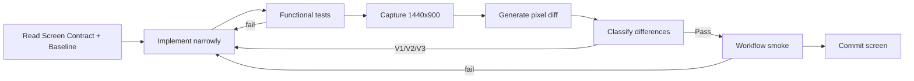

# 1HUB.NETWORK — PIXEL QA ARCHITECTURE v1.0

**Status:** FROZEN FOR CLAUDE IMPLEMENTATION WORKFLOW  
**Objective:** Make visual fidelity a repeatable engineering gate, not a subjective final review.

---

## 1. Source precedence

```text
Business SOT → behaviour/state
Data SOT     → entity/data semantics
Design SOT   → visual/layout/interaction presentation
```

If the Figma/exported reference conflicts with Business/Data SOT, fix the design mapping or document an intentional deviation. Never change business logic merely to increase visual similarity.

---

## 2. Pixel Source of Truth

Only approved files inside:

```text
design-reference/final/
```

may be used as pixel baselines.

Expected naming:

```text
WF01-S01__landing__1440x900.png
WF01-S02__auth__1440x900.png
WF02-S01__profile__1440x900.png
...
```

Raw Figma/Thảo exports stay immutable in `design-reference/source-thao/` and are not automatically approved baselines.

---

## 3. Viewport rule

### Standard web screen

```text
viewport: 1440 × 900 CSS px
DPR: 1
browser: pinned Chromium version
zoom: 100%
```

All workflow thumbnails/references must preserve this web ratio.

### Scrollable pages
Some source pages exceed 900px height.

Rules:
- browser viewport remains `1440×900`;
- capture an **above-fold viewport** for shell/alignment validation;
- optionally capture **full-page** screenshot for long-page fidelity;
- never resize a 1440×N source down to 1440×900 just to make it fit.

---

## 4. Deterministic visual state

Every reference screen must define a visual scenario:

```text
screen_id
route
actor/session
seed fixture
query params
viewport
scroll position
feature flags
expected state
```

Example:

```yaml
screen_id: WF01-S04
route: /onboarding/profile
actor: member_p0_01
fixture: p0_member_profile_draft
viewport: 1440x900
scroll_y: 0
motion: reduced
```

No random avatars, timestamps, IDs, recommendations or remote content in visual tests.

---

## 5. Capture harness

Recommended implementation: Playwright.

Before screenshot:

1. reset/load deterministic fixture;
2. authenticate actor through test helper;
3. open exact route;
4. set `1440×900`, DPR1;
5. set locale `vi-VN`;
6. set fixed timezone used by test fixture;
7. wait for network idle where appropriate;
8. `await document.fonts.ready`;
9. disable animation/transitions/caret blinking;
10. wait for stable layout marker;
11. capture.

Suggested test-only CSS:

```css
*, *::before, *::after {
  animation-duration: 0s !important;
  transition-duration: 0s !important;
  caret-color: transparent !important;
}
```

Do not use this CSS in production runtime.

---

## 6. Artifact structure

```text
visual-artifacts/
  actual/
    WF01-S01.png
  diff/
    WF01-S01.diff.png
  reports/
    WF01-S01.json
```

The comparison report records:

```text
screen_id
baseline_path
actual_path
diff_path
pixel_dimensions
raw_diff_ratio
masked_regions
classification
review_status
intentional_deviation_ref
```

---

## 7. Comparison method

Use two layers:

### Layer A — hard geometry checks
Fail immediately if:
- wrong viewport size;
- missing major block;
- wrong shell/header/sidebar dimensions;
- major overflow/clipping;
- incorrect scroll/route/state.

### Layer B — pixel/perceptual diff
Use a deterministic image-diff utility such as `pixelmatch` + `sharp`, or an equivalent library pinned in the repo.

Recommended initial configuration:

```text
pixel threshold: ~0.10–0.15
anti-alias handling: enabled/ignored where supported
```

Do not use the numerical score as the only pass/fail criterion.

---

## 8. Mismatch classification

Every meaningful visual difference is classified before code changes:

### V0 — Wrong state/source
Examples:
- incorrect actor;
- wrong dataset;
- wrong screen reference;
- missing font/assets.

**Action:** fix test setup/source mapping first.

### V1 — Structural
Examples:
- wrong layout/grid;
- missing section;
- wrong viewport behavior;
- wrong sidebar/header composition.

**Action:** mandatory fix.

### V2 — Major visual
Examples:
- typography scale;
- spacing system;
- component dimensions;
- main colors/background/borders.

**Action:** mandatory fix.

### V3 — Component detail
Examples:
- button/input/card styling;
- icon sizing;
- radius/shadow details.

**Action:** fix before final screen pass unless documented.

### V4 — Raster noise
Examples:
- anti-aliasing;
- fractional font raster differences;
- tiny browser image-render variance.

**Action:** ignore when geometry/style is correct.

### INTENTIONAL
Business/data state requires an approved visual difference.

**Action:** record in `VISUAL_DEVIATIONS.md`; never silently update baseline.

---

## 9. Pass gate

A screen passes only when:

```text
Functional state = PASS
V0 = none
V1 = none
V2 = none
V3 = none or explicitly approved
Pixel diff reviewed
No unexplained overflow/clipping
```

Numeric target can be used as a warning signal, not a substitute for review. A rough final target of <=1% material diff in stable areas is useful, but a 0.3% structural error may be worse than 2% anti-alias noise.

---

## 10. Screen implementation loop



Claude must stop after the requested screen/task instead of opportunistically implementing future screens.

---

## 11. Workflow regression gate

After each screen passes:
- rerun current workflow happy path;
- rerun visual smoke for shared shell/components affected;
- rerun already-passed critical screens if shared primitives changed.

Before completing a workflow:

```text
typecheck
lint
unit/integration relevant tests
build
workflow E2E
all workflow visual references
```

---

## 12. Shared component rule

When the same mismatch occurs on multiple screens, fix the shared primitive first:

```text
typography token
spacing token
AppShell
Sidebar
Topbar
Button
Input
Card
Table
Modal/Drawer
```

Do not patch 9 screens with page-specific CSS for one shared design-system defect.

---

## 13. Baseline change process

A baseline may change only when:
1. Design SOT is intentionally revised;
2. Screen Contract version is updated;
3. PO/Design approval is recorded;
4. old and new baseline are traceable.

Never solve a failed pixel test by blindly overwriting the expected image with the current implementation.

---

## 14. Suggested scripts

```text
npm run qa:visual:capture -- WF01-S01
npm run qa:visual:diff -- WF01-S01
npm run qa:visual -- WF01
npm run qa:workflow -- WF01
npm run qa:gate -- WF01-S01
```

The exact command implementation may vary by chosen frontend stack, but these concepts are mandatory.

